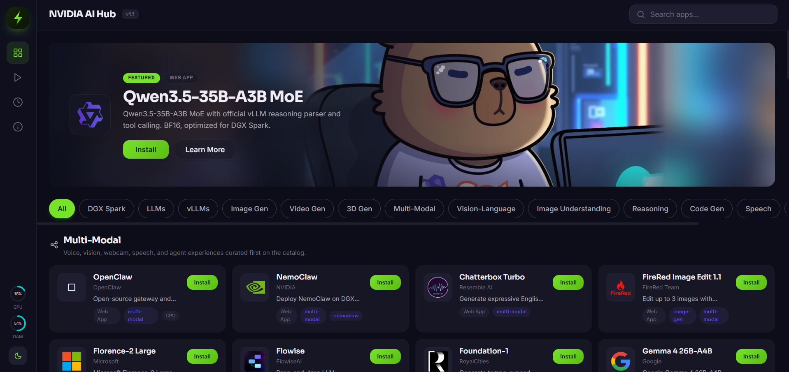

> [English](README.md) | **Tiếng Việt**

# NVIDIA AI Hub by Pho Tue SoftWare Solutions JSC  
## Một bản cập nhật lớn sẽ ra mắt vào tháng 8 năm 2026.

[](./CONTRIBUTING.vi.md)
[](./SECURITY.vi.md)
[](./LICENSE)
[](./COMMERCIAL-LICENSE.vi.md)
[](./docs/github-actions.vi.md)
[](https://github.com/hitechcloudvn/nvidia-ai-hub/stargazers)
[](https://github.com/hitechcloudvn/nvidia-ai-hub/issues)
[](./LICENSE)
[](https://github.com/hitechcloudvn/nvidia-ai-hub/commits/main)
[](https://github.com/hitechcloudvn/nvidia-ai-hub/graphs/contributors)
[](https://github.com/hitechcloudvn/nvidia-ai-hub)
[](https://github.com/hitechcloudvn/nvidia-ai-hub/pulls?q=is%3Apr+is%3Aclosed)
[](https://github.com/hitechcloudvn/nvidia-ai-hub/tags)
[](https://github.com/hitechcloudvn/nvidia-ai-hub/pulse)

🦊 **Bản sao GitLab:** https://gitlab.com/hitechcloudvn/nvidia-ai-hub

**Liên kết nhanh:** [Tổng quan](#tổng-quan) · [Cài đặt](./docs/installation.vi.md) · [Triển khai sản phẩm](./docs/deployment-production.vi.md) · [Phát triển cục bộ](./docs/local-development.vi.md) · [Kế hoạch](#kế-hoạch-và-lộ-trình) · [Đóng góp](#đóng-góp) · [Bảo mật](#bảo-mật-và-quy-tắc-ứng-xử) · [Cộng đồng](#cộng-đồng) · [Giấy phép](#giấy-phép)

**Cửa hàng ứng dụng AI của bạn cho các nền tảng GPU NVIDIA.** Duyệt, cài đặt và khởi chạy ứng dụng AI chỉ với một cú nhấp.



## Tổng quan

NVIDIA AI Hub by Pho Tue SoftWare Solutions JSC cung cấp giao diện web (web UI) và API để quản lý các recipe (công thức) ứng dụng AI được tuyển chọn trên các trạm làm việc, máy chủ và hệ thống lớp DGX dùng GPU NVIDIA.

Dự án bao gồm:

- Backend `FastAPI` để quản lý recipe, hệ thống và container
- Frontend `React + Vite` được backend phục vụ dưới dạng tệp tĩnh
- Shell desktop `Electron` tùy chọn cho các bản đóng gói Windows, macOS và Linux
- Mô hình runtime dựa trên Docker cho ứng dụng AI trong `registry/recipes`

## Phát triển cục bộ

Để có quy trình phát triển cục bộ hoàn chỉnh (backend + frontend), kiểm chứng bản build production và xử lý sự cố trang trắng, xem [`docs/local-development.md`](./docs/local-development.vi.md).

### Đóng gói ứng dụng desktop

Kho lưu trữ hiện có các tài nguyên đóng gói Electron tùy chọn trong `frontend/electron/`.

Việc đóng gói desktop hiện theo mô hình sau:

- web UI vẫn được build từ mã nguồn bằng Vite
- ứng dụng desktop khởi chạy một backend FastAPI cục bộ được đóng gói kèm trên `127.0.0.1`
- các bản đóng gói hướng tới Windows, macOS và Linux thông qua `electron-builder`
- các artifact Linux hướng tới việc kèm bundle ứng dụng desktop thay vì chỉ dựa vào trình cài đặt shell

Các lệnh desktop cho frontend:

- `npm run desktop:dev`
- `npm run desktop:pack`
- `npm run desktop:dist`

Các lệnh này được chạy từ `frontend/` và yêu cầu Python cục bộ cùng các phụ thuộc backend của kho lưu trữ để đóng gói thành công.

Ghi chú đóng gói desktop:

- biểu tượng ứng dụng được tạo từ `frontend/public/brand/spark-ai-hub-mark.svg` trong quá trình đóng gói desktop
- các bản build production của frontend hiện tách các phụ thuộc vendor lớn thành các chunk riêng để giảm kích thước bundle chính cho bản web và desktop
- các lệnh pack/dist desktop hiện xóa `frontend/release/` trước khi đóng gói để tránh các thư mục output cũ bị khóa trên Windows
- `npm install` trong `frontend/` hiện tự kiểm tra lại và sửa chữa bản cài đặt binary Electron không hoàn chỉnh
- việc ký Windows được thiết kế để điều khiển bằng `CSC_LINK` và `CSC_KEY_PASSWORD`
- việc ký và công chứng (notarization) macOS ngoài ra còn cần `CSC_NAME`, `APPLE_ID`, `APPLE_APP_SPECIFIC_PASSWORD` và `APPLE_TEAM_ID`
- lỗi tải Electron tạm thời từ các mirror upstream có thể biểu hiện thành HTTP `504` trong khi chạy `npm run desktop:dist`; chạy lại bản build là biện pháp xử lý đầu tiên được khuyến nghị

## Cài đặt và triển khai

Để biết cách triển khai Linux, giới hạn thiết lập Windows và macOS, điều kiện tiên quyết về Docker và runtime NVIDIA, và quản lý tiến trình PM2 tùy chọn, xem [`docs/installation.md`](./docs/installation.vi.md).

Để biết tự động hóa kho lưu trữ, đóng gói bản phát hành và build trình cài đặt, xem [`docs/github-actions.md`](./docs/github-actions.vi.md).

Để biết quản lý dịch vụ Linux kiểu production, thiết lập reverse proxy, TLS và hướng dẫn mở rộng kết nối mạng, xem [`docs/deployment-production.md`](./docs/deployment-production.vi.md).

Để xem các tệp ví dụ triển khai được theo dõi, xem [`deploy/systemd/nvidia-ai-hub@.service`](./deploy/systemd/nvidia-ai-hub@.service), [`deploy/nginx/nvidia-ai-hub.conf`](./deploy/nginx/nvidia-ai-hub.conf), [`deploy/caddy/Caddyfile`](./deploy/caddy/Caddyfile) và [`deploy/pm2/ecosystem.config.cjs`](./deploy/pm2/ecosystem.config.cjs).

## Đóng góp

Xem [`CONTRIBUTING.md`](./CONTRIBUTING.vi.md) để biết quy trình đóng góp, thiết lập phát triển, hướng dẫn về recipe và các yêu cầu đối với pull request.

## Bảo mật và Quy tắc ứng xử

- Chính sách bảo mật: [`SECURITY.md`](./SECURITY.vi.md)
- Quy tắc cộng đồng và cộng tác: [`CODE_OF_CONDUCT.md`](./CODE_OF_CONDUCT.vi.md)

## Cộng đồng

- Hướng dẫn đóng góp: [`CONTRIBUTING.md`](./CONTRIBUTING.vi.md)
- Chính sách bảo mật: [`SECURITY.md`](./SECURITY.vi.md)
- Quy tắc ứng xử: [`CODE_OF_CONDUCT.md`](./CODE_OF_CONDUCT.vi.md)
- Hướng dẫn hỗ trợ: [`SUPPORT.md`](./SUPPORT.vi.md)
- Chỉ mục quản trị: [`docs/community.md`](./docs/community.vi.md)
- Hướng dẫn triển khai GitHub Actions: [`docs/github-actions.md`](./docs/github-actions.vi.md)
- Hướng dẫn bảo trì kho lưu trữ: [`docs/maintenance.md`](./docs/maintenance.vi.md)
- Quy trình pull request: [`docs/pull-request-process.md`](./docs/pull-request-process.vi.md)
- Hướng dẫn giấy phép: [`docs/licensing.md`](./docs/licensing.vi.md)
- Thảo luận: bật GitHub Discussions trong cài đặt kho lưu trữ cho các câu hỏi hỗ trợ, ý tưởng và trao đổi về lộ trình
- Tài trợ và giấy phép thương mại: [`COMMERCIAL-LICENSE.md`](./COMMERCIAL-LICENSE.vi.md)

## Vận hành kho lưu trữ

Để tự động hóa kho lưu trữ, duy trì quản trị và định tuyến review, hãy dùng:

- Hướng dẫn triển khai GitHub Actions: [`docs/github-actions.md`](./docs/github-actions.vi.md)
- Hướng dẫn bảo trì kho lưu trữ: [`docs/maintenance.md`](./docs/maintenance.vi.md)
- Quy trình pull request: [`docs/pull-request-process.md`](./docs/pull-request-process.vi.md)

## Kế hoạch và lộ trình

Kho lưu trữ giữ định hướng sản phẩm, thứ tự triển khai và kế hoạch mở rộng danh mục trong các tài liệu kế hoạch được theo dõi.

- Bản thiết kế sản phẩm: [`planning/sparkdeck-project-blueprint.md`](./planning/sparkdeck-project-blueprint.vi.md)
- Backlog triển khai và kế hoạch giao hàng theo giai đoạn: [`planning/development-execution-plan.md`](./planning/development-execution-plan.vi.md)
- Kế hoạch tìm nguồn registry và mở rộng theo lô: [`planning/registry-expansion-roadmap.md`](./planning/registry-expansion-roadmap.vi.md)

Hãy dùng các tài liệu này cùng nhau:

- `sparkdeck-project-blueprint.md` định nghĩa mô hình sản phẩm dài hạn và kiến trúc tính năng
- `development-execution-plan.md` chuyển mô hình đó thành các luồng công việc triển khai có giới hạn và các giai đoạn
- `registry-expansion-roadmap.md` điều phối các lô mở rộng recipe, độ phủ banner và cân bằng danh mục

Khi phạm vi sản phẩm, định vị pháp lý hoặc ưu tiên triển khai thay đổi, hãy giữ các tệp kế hoạch đồng bộ với `README.md`, `docs/community.md` và các tài liệu quản trị liên quan.

## Thông báo pháp lý và Ghi nhận thương hiệu

`NVIDIA AI Hub by Pho Tue SoftWare Solutions JSC` là một giải pháp phần mềm được phát triển và phân phối bởi **Pho Tue SoftWare And Technology Solutions Joint Stock Company** (gồm thương hiệu **HiTechCloud**).

Thông tin công ty:

- Tên pháp nhân: **CÔNG TY CỔ PHẦN GIẢI PHÁP CÔNG NGHỆ VÀ PHẦN MỀM PHỔ TUỆ**
- Tên tiếng Anh: **Pho Tue SoftWare And Technology Solutions Joint Stock Company**
- Mã số thuế: `0318222903`
- Số D-U-N-S: `557339920`
- Địa chỉ: `128 Binh My Street, Binh My Commune, Ho Chi Minh City`

`NVIDIA AI Hub by Pho Tue SoftWare Solutions JSC`, các yếu tố thương hiệu liên quan trong kho lưu trữ và cách trình bày sản phẩm liên quan trong kho lưu trữ này là các định danh độc quyền được dùng cho giải pháp này.

`NVIDIA`, logo `NVIDIA`, `DGX`, `CUDA` và các tên sản phẩm hoặc chương trình khác của NVIDIA là các thương hiệu và/hoặc thương hiệu đã đăng ký của **NVIDIA Corporation** và các công ty liên kết tại Hoa Kỳ và các quốc gia khác.

Mọi đề cập đến phần cứng, phần mềm, nền tảng, runtime hoặc công nghệ hệ sinh thái NVIDIA trong kho lưu trữ này chỉ được cung cấp nhằm mô tả khả năng tương thích, yêu cầu triển khai hoặc ngữ cảnh tích hợp.

Không phát ngôn nào trong kho lưu trữ này được hiểu là:

- cấp bất kỳ giấy phép nào để sử dụng thương hiệu NVIDIA ngoại trừ việc chỉ danh hợp pháp (lawful nominative reference);
- ngụ ý tài trợ, chứng thực, chứng nhận, hợp tác hoặc chấp thuận bởi NVIDIA Corporation, trừ khi mối quan hệ đó được nêu rõ bằng văn bản; hoặc
- chuyển giao bất kỳ quyền sở hữu nào đối với tên, logo, hình dáng thương mại (trade dress) hoặc tài sản thương hiệu của Pho Tue SoftWare And Technology Solutions Joint Stock Company, NVIDIA Corporation hoặc bất kỳ bên thứ ba nào khác.

Tên sản phẩm ngắn `NVIDIA AI Hub` và tên sản phẩm đầy đủ `NVIDIA AI Hub by Pho Tue SoftWare Solutions JSC` đều chỉ cùng một giải pháp phần mềm được mô tả trong kho lưu trữ này.

Mọi tên thương mại, thương hiệu, nhãn hiệu dịch vụ, logo và đặc trưng thương hiệu khác được đề cập trong kho lưu trữ này vẫn thuộc quyền sở hữu của các chủ sở hữu tương ứng.

Đối với điều khoản pháp lý chi phối, hãy xem [`LICENSE`](./LICENSE), [`NOTICE`](./NOTICE), [`COMMERCIAL-LICENSE.md`](./COMMERCIAL-LICENSE.vi.md), [`docs/licensing.md`](./docs/licensing.vi.md), [`docs/legal-notice.md`](./docs/legal-notice.md) và bản tiếng Việt [`docs/legal-notice.vi.md`](./docs/legal-notice.vi.md).

## Cài đặt nhanh

```bash
curl -fsSL https://raw.githubusercontent.com/hitechcloudvn/nvidia-ai-hub/main/install.sh | bash
```

Cài đặt mà không khởi động máy chủ:

```bash
curl -fsSL https://raw.githubusercontent.com/hitechcloudvn/nvidia-ai-hub/main/install.sh | bash -s -- --no-start
```

Cài đặt trên cổng tùy chỉnh:

```bash
curl -fsSL https://raw.githubusercontent.com/hitechcloudvn/nvidia-ai-hub/main/install.sh | bash -s -- --port 9010
```

Cài đặt trên host và cổng tùy chỉnh:

```bash
curl -fsSL https://raw.githubusercontent.com/hitechcloudvn/nvidia-ai-hub/main/install.sh | bash -s -- --host 127.0.0.1 --port 9010
```

### Thiết lập cục bộ trên Windows

Dùng hướng dẫn phát triển cục bộ để có các lệnh tương thích Windows:

- [`docs/local-development.md`](./docs/local-development.vi.md)

Để biết giới hạn nền tảng được hỗ trợ và hướng dẫn triển khai, xem [`docs/installation.md`](./docs/installation.vi.md).

Sau khi cài đặt, mở:

- `http://localhost:9000`
- hoặc `http://<your-host-ip>:9000` từ thiết bị khác trong cùng mạng

Chạy lại chính lệnh đó để cập nhật.

## Trình cài đặt làm gì

Trình cài đặt được thiết kế để tự động chuẩn bị cả backend lẫn frontend.

Trình cài đặt sẽ:

1. Cài đặt `git` nếu chưa có
2. Cài đặt `python3`, `python3-venv` và `pip` nếu chưa có
3. Cài đặt Docker Engine nếu chưa có
4. Cài đặt Node.js 22.x nếu phiên bản hệ thống không phù hợp để build frontend
5. Clone hoặc cập nhật kho lưu trữ `nvidia-ai-hub` trong `$HOME/nvidia-ai-hub`
6. Tạo môi trường ảo Python trong `.venv`
7. Cài đặt phụ thuộc backend từ `requirements.txt`
8. Cài đặt phụ thuộc frontend từ `frontend/package.json`
9. Build frontend production vào `frontend/dist`
10. Tạo `.env` từ `.env.example` khi cần
11. Ghi bền `NVIDIA_AI_HUB_HOST` và `NVIDIA_AI_HUB_PORT` vào tệp `.env` gốc
12. Khởi động backend bằng `./run.sh` với host và cổng đã cấu hình

Vì backend phục vụ frontend đã build từ `frontend/dist`, giao diện sẵn sàng ngay sau khi cài đặt.

Nếu dùng `--no-start` hoặc `-NoStart`, trình cài đặt hoàn tất mọi bước thiết lập nhưng bỏ qua việc khởi chạy API server.

Nếu dùng `--port`, `--host`, `-Port` hoặc `-Host` trong khi cài đặt, các giá trị đã chọn sẽ được ghi vào tệp `.env` gốc dùng chung.

`run.sh` cũng hỗ trợ `--host` và `--port` để ghi đè dùng một lần, ngược lại sẽ đọc các giá trị đã ghi bền từ `.env`.

## Tính năng

- Duyệt danh mục ứng dụng AI sẵn sàng cho các nền tảng GPU NVIDIA
- Cài đặt bất kỳ ứng dụng nào chỉ với một cú nhấp — không cần terminal
- Khởi chạy, dừng và theo dõi các ứng dụng đang chạy từ bảng điều khiển
- Theo dõi GPU, RAM, ổ đĩa và nhiệt độ theo thời gian thực

## Ứng dụng sẵn có

| Ứng dụng | Chức năng | GPU |
|-----|-------------|-----|
| Open WebUI + Ollama | Chat với LLM cục bộ | Có |
| vLLM (Qwen 3.5) | Suy luận LLM hiệu năng cao (8 kích thước mô hình) | Có |
| ComfyUI | Quy trình tạo ảnh và video | Có |
| FaceFusion | Hoán đổi và tăng cường khuôn mặt | Có |
| Hunyuan3D 2.1 | Tạo mô hình 3D từ ảnh | Có |
| TRELLIS 2 | Tạo 3D từ văn bản/ảnh | Có |
| LocalAI | Máy chủ API tương thích OpenAI | Có |
| AnythingLLM | RAG và AI agent | Không |
| Flowise | Quy trình LLM kéo-thả | Không |
| Langflow | Trình dựng ứng dụng LLM trực quan | Không |

Các ứng dụng được cung cấp dưới dạng workload dựa trên Docker có tích hợp runtime NVIDIA. Kiến trúc và yêu cầu GPU thay đổi tùy theo recipe.

## Yêu cầu

### Tối thiểu

- Máy chủ Linux với GPU NVIDIA được hỗ trợ, Docker Engine và NVIDIA Container Toolkit hoặc tích hợp runtime NVIDIA tương đương
- Môi trường Linux dựa trên Ubuntu/Debian có `apt-get`
- Truy cập Internet trong quá trình cài đặt
- Quyền dùng `sudo` để cài đặt gói

### Được cài đặt tự động

- Git
- Python 3 + venv
- Docker Engine
- Node.js 22.x

## Vận hành thủ công

### Cập nhật bản cài đặt hiện có

Chạy lại trình cài đặt:

```bash
curl -fsSL https://raw.githubusercontent.com/hitechcloudvn/nvidia-ai-hub/main/install.sh | bash
```

### Khởi động thủ công từ bản sao sẵn có

Nếu kho lưu trữ đã có sẵn trên máy:

```bash
./run.sh
```

Trước khi khởi động, bạn có thể kiểm tra trạng thái máy bằng:

```bash
./check.sh
```

`run.sh` hiện kiểm tra `frontend/dist` có bị thiếu hoặc lỗi thời hay không. Nếu cần, lệnh sẽ tự build lại giao diện trước khi khởi động backend.

Bạn cũng có thể khởi động trên cổng tùy chỉnh cho một lần chạy:

```bash
./run.sh --port 9010
```

Bạn cũng có thể ghi đè host và cổng cho một lần chạy:

```bash
./run.sh --host 127.0.0.1 --port 9010
```

Nếu có `.env`, `run.sh` dùng `NVIDIA_AI_HUB_HOST` và `NVIDIA_AI_HUB_PORT` làm mặc định.

Nếu phải build lại frontend, đảm bảo máy có:

- `node` >= 22
- `npm`

### URL dịch vụ mặc định

- Giao diện: `http://localhost:9000`
- Gốc API: `http://localhost:9000`

## Lưu ý về Windows

Phát triển cục bộ trên Windows được hỗ trợ qua các lệnh Python và npm tiêu chuẩn. Dùng [`docs/local-development.md`](./docs/local-development.vi.md) để biết hướng dẫn thiết lập và chạy.

Windows được tài liệu hóa như một môi trường phát triển chứ không phải đích triển khai GPU cục bộ chính. Xem [`docs/installation.md`](./docs/installation.vi.md) để biết giới hạn nền tảng.

## Cấu hình dùng chung

Kho lưu trữ hiện có định dạng tệp cục bộ `.env` dùng chung ở gốc, với `.env.example` được commit làm mẫu, được dùng bởi:

- `daemon/config.py`
- `install.sh`
- `run.sh`
- `check.sh`

Các giá trị mặc định bao gồm:

- `NVIDIA_AI_HUB_HOST`
- `NVIDIA_AI_HUB_PORT`
- `NVIDIA_AI_HUB_NODE_MAJOR`
- `NVIDIA_AI_HUB_REGISTRY_PATH`
- `NVIDIA_AI_HUB_DATA_DIR`
- `NVIDIA_AI_HUB_DB_PATH`

Để tạo cấu hình cục bộ thủ công:

```bash
cp .env.example .env
```

hoặc trong PowerShell:

```powershell
Copy-Item .env.example .env
```

`install.sh` tự tạo `.env` từ `.env.example` khi cần.

Cập nhật `.env` nếu bạn muốn giữ host, cổng hoặc bố cục đường dẫn mặc định tùy chỉnh qua các lần chạy.

## Xử lý sự cố

### Trang mở ra nhưng không có CSS hoặc JavaScript

Điều này thường nghĩa là bản build frontend chưa được tạo. Chạy lại trình cài đặt để build lại `frontend/dist`.

Bạn cũng có thể chạy `./check.sh` để xác nhận bundle frontend có bị thiếu hoặc lỗi thời hay không.

### Docker chỉ chạy được với sudo

Trình cài đặt thêm người dùng hiện tại vào nhóm `docker`. Hãy đăng xuất rồi đăng nhập lại, hoặc chạy:

```bash
newgrp docker
```

### `python3 -m venv .venv` thất bại

Đảm bảo `python3-venv` đã được cài đặt. Trình cài đặt sẽ cố cài đặt nó tự động.

### Build frontend thất bại vì phiên bản Node.js

Trình cài đặt cài Node.js 22.x khi phát hiện phiên bản quá cũ. Chạy lại trình cài đặt nếu phiên bản Node của hệ thống thay đổi bất thường.

### `run.sh` thoát với thông báo yêu cầu build frontend

Điều này nghĩa là bundle giao diện được commit hoặc sinh ra đang thiếu hoặc lỗi thời, và máy hiện tại không có bộ công cụ Node.js tương thích. Chạy `install.sh` để chuẩn bị Node.js và build lại frontend.

### `check.sh` báo không thể kết nối Docker daemon

Khởi động Docker Desktop hoặc dịch vụ Docker, sau đó chạy lại `./check.sh`. NVIDIA AI Hub by Pho Tue SoftWare Solutions JSC chỉ có thể khởi động mà không có Docker trong trạng thái UI/API hạn chế.

### Cài đặt phụ thuộc trên Windows thất bại

Cài đặt thủ công Git, Python 3.11+, Node.js 22+ và Docker Desktop, sau đó làm theo [`docs/local-development.md`](./docs/local-development.vi.md).

## Gỡ cài đặt

```bash
curl -fsSL https://raw.githubusercontent.com/hitechcloudvn/nvidia-ai-hub/main/uninstall.sh | bash
```

Giữ lại dữ liệu runtime cục bộ khi gỡ cài đặt:

```bash
./uninstall.sh --keep-data
```

Trình gỡ cài đặt hiện xóa, theo thứ tự sau:

- các container, image và volume recipe của NVIDIA AI Hub by Pho Tue SoftWare Solutions JSC
- các đường dẫn cache/runtime của backend như `.venv` và `data/`
- các đường dẫn cache/build của frontend như `frontend/node_modules` và `frontend/dist`
- các tệp `.env` recipe được sinh ra
- các thư mục cache Python như `__pycache__`
- chính thư mục cài đặt

Trình gỡ cài đặt không gỡ bỏ Docker.

Để biết tiêu chuẩn và mẫu đóng góp cho kho lưu trữ, xem [`CONTRIBUTING.md`](./CONTRIBUTING.vi.md).

## Giấy phép

Kho lưu trữ này được cấp phép cho **việc sử dụng phi thương mại nghiêm ngặt** theo các điều khoản của [`LICENSE`](./LICENSE).

Copyright (c) 2026 HiTechCloud by Pho Tue SoftWare Solutions JSC.

Việc sử dụng thương mại, bàn giao cho khách hàng, dịch vụ có thu phí, phân phối SaaS, tái phân phối qua marketplace và các hình thức sử dụng tạo doanh thu khác đều cần sự cho phép bằng văn bản riêng từ chủ sở hữu bản quyền. Xem [`COMMERCIAL-LICENSE.md`](./COMMERCIAL-LICENSE.vi.md) và [`docs/licensing.md`](./docs/licensing.vi.md).
